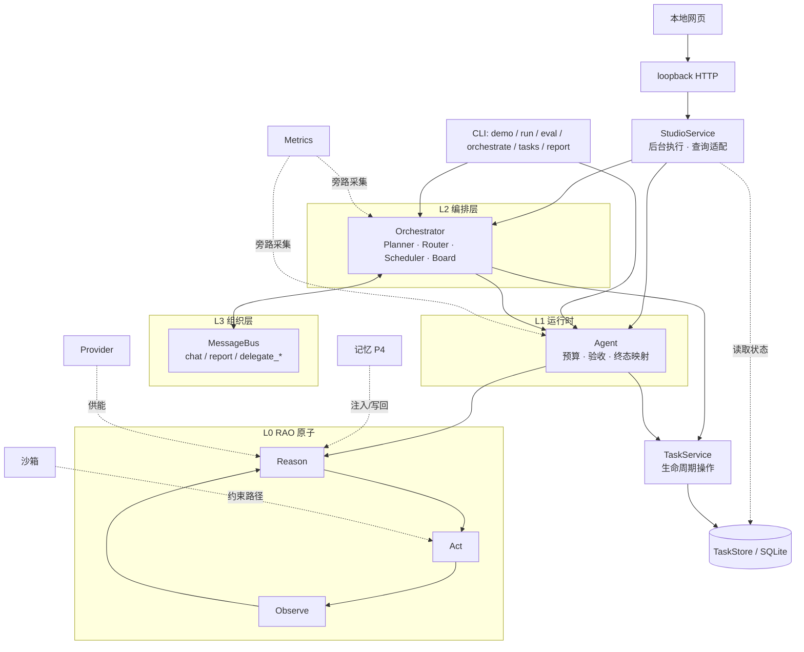
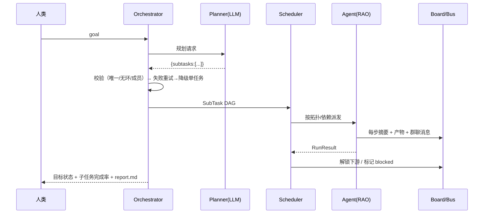

# 系统架构设计

## 当前本地工作室

Studio 采用同源、单进程部署。浏览器运行静态 HTML、CSS 和 JavaScript，通过 JSON HTTP 接口创建会话、提交任务、读取日志、下载工件和回答业务问题。Python 同时提供静态资源和 API。页面可见时每 1.8 秒轮询，活跃任务由后台工作线程运行。浏览器与后端之间已有可独立测试的接口。[网页入口](../miniagent/web/app.js) · [HTTP 适配器](../miniagent/studio_server.py)

| 边界 | 本版职责 | 正常入口 |
| --- | --- | --- |
| 会话、项目和持久身份 | 角色有固定 ID。私聊和群聊的下一轮可沿用历史分工及用户选定的工作区。角色通用或项目专用的记忆、技能提议支持审核、修订和恢复。 | [角色库](personal-role-library.md) · [会话与工作区](../miniagent/studio_service.py) |
| 群内执行 | 本群负责人按职责委派。成员在隔离目录工作，通过交接传递文件、检查结果和版本。独立评审能对冻结候选逐项核查，发现产品缺口后发回作者。 | [团队协作](studio-team-workflow.md) · [版本验收](../miniagent/studio_reviews.py) |
| 模型请求 | 按单次请求窗口预留输出空间。接近水位时收缩发送视图，保留近期完整工具批次和人工问答。滚动摘要记录被移出的目标、决定、产物、检查和阻塞。原始运行轨迹单独保留。 | [窗口投影](../miniagent/request_window.py) · [增量摘要](../miniagent/compaction.py) |
| 结束与预算 | 默认网页可用 0 表示不限模型步数和累计 tokens。有明确用户上限时执行该上限。结束还取决于当前交付版本、验收、可用时间、取消或可复现的无进展。 | [运行循环](../miniagent/agent.py) · [预算实测](evidence/2026-11-18-optional-turn-budget.md) |

Python 源码以一个 `miniagent` 包和 `contracts` 子包为主。后续拆包时，可先把会话 HTTP 适配、群内调度、评审、资料检索和工作区投影各自收拢，以 API 和现有测试约束迁移。单纯搬动文件不能解决负责人把旧的错误当作当前验收结果的问题，版本和回执应由运行时维护。[来源与交接](research-and-project-data.md) · [社区实现对照](agent-harness-research.md)

## 原运行时架构基线

> M0-04 已将任务、Attempt/Run、验收记录和 outbox 接入 SQLite，Board 继续作为投影；当前持久化与恢复边界见 [TaskStore 说明](m0-04-task-store.md)。

> 2026-11-16 更新：本文保留原架构基线，验收与指标已按 [M0-02](m0-02-acceptance-and-metrics.md) 更新；其余未接入的持久化、隔离与预算能力仍以分阶段计划为准。

> 一个可运行的**多智能体协作系统**：以 RAO 为原子单元，在其上叠加运行时、编排器、消息总线与观测层。
> 本文是系统级视图；**执行单元的字段级契约**见 [rao-spec.md](rao-spec.md)，
> **调度算法与选型**见 [scheduler.md](scheduler.md)。

| 项 | 内容 |
|---|---|
| 版本 | v2.0 架构基线，叠加 M0-01 至 M0-04 与 M0-UI-01 |
| 日期 | 基线 2026-11-03，工作室现状更新于 2026-11-18 |
| 状态 | L0 RAO ✅ · L1 运行时 ✅ · L2 编排 ✅ · L3 组织 ✅部分 · L4 观测 ✅ · 长期角色记忆现状见上方工作室章节 |
| 代码基线 | 初始 13 个模块、96 个测试为历史基线；M0-04 时 504 个测试，最新 GUI 验证见对应交付文档 |
| 对应课程要求 | 2.1 通信与协作 · 2.2 记忆演化与隔离 · 2.3 行动空间 · 2.4 纯文本 · 2.5 极简 UI · 2.6 标准化 LLM 主干 · 评估指标 |

---

## 1. 摘要

执行核心按 L0–L4 分层，入口和持久控制层复用这些职责：

| 层 | 一句话职责 | 代码 |
|---|---|---|
| 用户入口 | 本地网页、HTTP 适配、后台任务管理与查询 | `web/`、`studio_server.py`、`studio_service.py`、`cli.py` |
| 持久控制 | Task/Attempt/Run、验收历史、状态事务与 outbox | `task_service.py`、`task_store.py` |
| **L0 RAO** | 一步 = Reason（决策）→ Act（执行）→ Observe（归一化观察） | `rao.py` |
| **L1 运行时** | 驱动 RAO 直到终止：预算、验收、终态映射、trace | `agent.py` |
| **L2 编排** | 把目标拆成子任务 DAG，按依赖调度 | `orchestrator.py` |
| **L3 组织** | 多 agent 共享频道、委派、黑板 | `bus.py` + `orchestrator.py` |
| **L4 观测** | 事件流 → 完成率 / 耗时 / 失败分类 → 报告 | `metrics.py` |
| 横切 | 工具、沙箱、模型接入 | `tools.py` `sandbox.py` `providers.py` |

三条贯穿全局的设计判断：

1. **决策是闭集**：模型每步只能在 `act / answer / ask_human / delegate / abort` 里选一个。
2. **完成由代码判定**：`completed` 必须有验收函数通过，不接受"模型说做完了"。
3. **指标只有一个来源**：所有数字由 `trace.jsonl` 派生，禁止任何模块旁路计算。

---

## 2. 设计目标、非目标与不变量

### 2.1 目标

| # | 目标 | 可检验判据 |
|---|---|---|
| G1 | 一句目标端到端完成 | `orchestrate` 一条命令产出产物文件 + 报告 |
| G2 | 多智能体自主分解与委派 | 同一目标可产出不同子任务图；agent 可 `delegate_task` 派子任务 |
| G3 | 指标自动、可追溯 | 一个命令出表，每个数字可追到 trace 行 |
| G4 | 隔离可演示 | agent A 读不到 agent B 的工作区 |
| G5 | 无密钥可开发 | ScriptedProvider 全链路可跑，网页包含离线演示 |

### 2.2 非目标（明确不做）

- ❌ PDF / DOCX / PPT 的解析与生成（课程 2.4 明令）
- ❌ 与任务无关的复杂前端；课程 2.5 允许基础网页界面，本地 GUI 以任务操作与观测为范围
- ❌ 微服务 / 分布式调度（单进程线程池足够，见 §9）
- ❌ 模型训练 / 微调

### 2.3 不变量（改代码时不许破坏）

1. **决策闭集**：自由文本必须先落到 `answer`。
2. **观察归一**：任何执行结果都是 `Observation`，失败带 `error_class`。
3. **历史只追加**：`RAOState.history` append-only，便于重放与审计。
4. **预算单调递减**：步数 / 时间 / token / 动作四个维度只减不增。
5. **完成需验收**：无验收函数时为 `unverified`；只有有效 Spec/Report 与检查回执支持的正常完成才计入成功。
6. **单一指标来源**：`trace.jsonl`。
7. **工具不抛异常**：错误是一等公民，不是崩溃。

---

## 3. 分层架构



### 3.1 组件状态

| 层 | 组件 | 文件 | 状态 |
|---|---|---|---|
| 入口 | 本地网页任务控制台 | `web/`、`studio_server.py`、`studio_service.py` | M0-UI-01 |
| 控制 | 持久任务与事务状态 | `task_service.py`、`task_store.py` | M0-04 |
| L0 | RAO 原子（决策闭集 / 观察归一 / 预算 / 循环检测 / 验收） | `rao.py` | ✅ |
| L1 | Agent 运行时（循环 / 预算 / 验收打回 / 终态映射 / trace） | `agent.py` | ✅ |
| L2 | 编排器（计划校验 / 降级 / 路由 / S1·S2·S3 调度 / 黑板） | `orchestrator.py` | ✅ |
| L3 | 消息总线（群聊 / 私信 / 委派事件） | `bus.py` | ✅ |
| L3 | 委派（`delegate_task` 真执行、限深 2） | `orchestrator.py` | ✅ |
| L3 | HITL 跨进程挂起/恢复 | — | ⏳ 未做 |
| L4 | 指标（任务 / 子任务 / 总体目标 / 失败分类） | `metrics.py` | ✅ |
| 横切 | 工具（文件 4 + 代码 + 网络 + 3 个控制工具） | `tools.py` | ✅ |
| 横切 | 沙箱（L1 软隔离：路径 jail + 越狱检测） | `sandbox.py` | ✅ |
| 横切 | 模型接入（DeepSeek / Scripted / HKGAI 预留） | `providers.py` | ✅ |
| 横切 | 记忆与演化（episodic + semantic + skills） | `memory.py` | ⏳ P4 |

---

## 4. L0：RAO 原子

```
s_{t+1} = Observe( Act( Reason(s_t) ) )
```

| 阶段 | 输入 | 输出 | 失败处理 |
|---|---|---|---|
| Reason | 状态（目标、历史、预算） | `Decision`（闭集五选一） | 输出非法 → `R_INVALID_DECISION`，回灌重试 |
| Act | `Decision.actions[]` | 原始结果 | 沙箱拒绝/超时/异常 → 失败观察，不中断 |
| Observe | 原始结果 | `Observation{ok, content, error_class, artifacts, bytes}` | 截断 → `truncated=True` 记账 |

**为什么对象化观察**：ReAct 把工具结果当自由文本塞回上下文；一旦对象化，才能做失败分类、
上下文预算、产物索引、记忆蒸馏和指标归因。完整契约（字段、15 个错误码、终止谓词、单步测试方法）
见 **[rao-spec.md](rao-spec.md)**。

三个与模型协议相关的实现细节：

- `ask_human` / `delegate_task` / `abort_task` 是**控制工具**：RAO 拦截名字转成决策形态，
  但仍然回一条 `role=tool` 消息（否则下一轮请求 400）。
- 控制工具不可用时**诚实降级**（`A_UNSUPPORTED` 并提示自行完成），不假装成功。
- 同一动作（工具 + 规范化参数的 SHA1）连续 3 次告警、5 次终止（`T_LOOP`）。

---

## 5. L1：运行时

循环只做四件事：取预算、`RAOUnit.step()`、判终止、记 trace。

```
while 预算未耗尽:
    record = unit.step(state, budget)      # 一步
    if record.terminate_reason:  终态映射
    if record.decision_kind == "answer":
        验收通过 → completed
        验收失败 → 打回一次（注入原因）→ 仍失败 → failed_acceptance
```

| 终态 | 触发 | 含义 |
|---|---|---|
| `completed` | 独立验收通过，且报告及回执可核对 | 成功 |
| `unverified` | 缺少可用验收 | 保留候选结果，不计成功 |
| `failed_acceptance` | 打回后仍不通过 | 模型说完成但产物不合格 |
| `limit_exceeded` | 预算耗尽 / `T_LOOP` | 停损 |
| `aborted` | 模型 `abort_task` | 主动放弃 |
| `error` | Provider 异常 | 基础设施故障 |

验收函数是一段代码，三种常用写法：文件存在非空 → 结构断言（标题数 / JSON schema）→ 断言脚本或 reviewer agent。

---

## 6. L2：编排

### 6.1 流水线



### 6.2 三个子职责

| 职责 | 做法 | 失败策略 |
|---|---|---|
| **Planner** | LLM 产出结构化 JSON，代码严格校验 | 重试 1 次 → 降级单任务（`plan_degraded`） |
| **Router** | 能力表匹配：指定成员 → 技能关键词 → 默认 worker | 总能落到一个真实成员 |
| **Scheduler** | 串行 / 分层并发 / 事件驱动三种实现 | 失败只阻塞下游（局部失败语义） |

调度算法、预算、并发安全与实测对比见 **[scheduler.md](scheduler.md)**。这里只强调一条：
**计划可以由模型给，调度必须由代码做**——否则完成率不可复现，也无法做失败归因。

---

## 7. L3：组织层

### 7.1 消息总线

| 字段 | 说明 |
|---|---|
| `sender` / `recipients[]` | 谁发的、发给谁（`all`/`*` 表示广播） |
| `kind` | `system` / `report` / `delegate_request` / `delegate_result` / `chat` |
| `content` / `task_id` | 内容与关联任务 |
| `id` / `ts` / `iso` | 单调递增 id（跨线程排序）+ 时间戳 |

落盘 `runs/<id>/bus.jsonl`。两种用法：

- **群聊演示**：每个 agent 的最终答复以 `report` 消息进入共享频道；
- **委派审计**：`delegate_request` / `delegate_result` 成对出现，报告可引用。

### 7.2 委派

```
agent 调 delegate_task(objective, assignee?, acceptance?)
  → Orchestrator 按平台 action_id 幂等登记独立 child task_id
  → 同步执行（继承预算、独立沙箱）
  → 结果作为一条 Observation 返回给父 agent
```

深度上限默认 2，超限返回 `A_UNSUPPORTED`；未启用委派时同样诚实降级。

### 7.3 黑板

`Board` 记录每个子任务每一步的摘要、产物索引与错误类，落 `board.json`。
分工原则：总线记录交流事件，黑板提供状态摘要投影；**任务生命周期的持久真源是 TaskStore**。浏览器同样读取持久任务记录，不以黑板或动画推断任务成功。

---

## 8. 记忆与演化（P4，设计中）

设计已定、代码未写。要点：

| 层 | 内容 | 写入 | 读取 |
|---|---|---|---|
| Episodic | 一次任务的轨迹摘要（目标、结果、失败类、关键动作） | 任务结束 | 同类任务开始前 |
| Semantic | 归纳出的教训 / 策略，带置信度与来源 | 离线 consolidate | 每步 Reason 前 top-k |
| Skills | 可复用工具序列（参数化） | 成功且被复用 | 规划阶段 |

演化闭环：`record → consolidate → retrieve → inject → measure`。
度量用同任务集 A/B：`evolution_gain = (CR_memory − CR_nomemory) / CR_nomemory`，
并对比平均步数。低置信教训不注入；A/B 可一键关闭注入，防止"记忆污染"。

---

## 9. 隔离、并发与状态

### 9.1 沙箱分级

| 级别 | 手段 | 能挡 | 挡不住 | 本项目 |
|---|---|---|---|---|
| L1 | 独立目录 + 路径校验（绝对路径 / `..` / 盘符 / 符号链接） | 手滑、跨 agent 误读、提示词诱导越界 | 恶意代码主动访问绝对路径 | ✅ 已实现 |
| L2 | 每 agent 子进程 + 资源限制 | 大部分失控脚本 | 提权类攻击 | 未做 |
| L3 | 容器（只挂载自己目录、无网络） | 强隔离、可复现 | 启动成本 | 未做 |

写架构文档时**明确声明残余风险**，比假装安全更能得分。

### 9.2 并发模型

- 单进程 + `ThreadPoolExecutor`（LLM 调用是 I/O 密集，线程足够）。
- 写者唯一：每个子任务独立 sandbox 目录。
- `Tracer` / `Board` 内部加锁；`ScriptedProvider` 非线程安全 → CLI 拒绝 `--mock` 配并发/事件驱动。
- 预算：每子任务 `Limits × 0.8` 独立预算 + 全局 token/时间池兜底（池空 → 剩余标 `skipped`）。

### 9.3 状态与重放

事件日志优先：状态可由 `trace.jsonl` 重放得出；崩溃恢复点 = 最后一个 `task_end`。
文件写入先临时文件再原子替换（避免半成品被下游读到）。

---

## 10. 安全模型

| 威胁 | 攻击路径 | 缓解 | 残余风险 |
|---|---|---|---|
| 路径越界 | `../`、绝对路径、符号链接 | `Sandbox.resolve` 全路径校验 | L1 下恶意代码可绕过 |
| 提示词注入 | 网页/文件里藏"忽略之前的指令" | 外部内容标注为不可信数据、危险操作过审批 | 模型仍可能被说服做 read 类越权 |
| 破坏性操作 | 删文件、覆盖产物、git push | `danger` 级必须过 `approve`；无人值守模式也留痕 | 自动批准时可能误删 |
| SSRF | 诱导访问内网 | 私有地址 / 域名黑名单 | 3xx 跳转未逐跳校验（代码有 TODO） |
| 资源耗尽 | 死循环、长脚本、上下文爆炸 | 四维预算 + 工具超时 + 输出截断 | 内存型攻击未限制（L2 加 rlimit） |
| 凭据泄漏 | 把 key 写进文件或日志 | 密钥只从环境变量注入 | 模型可能把 key 抄进产物（需正则扫描） |

---

## 11. 观测与指标

### 11.1 事件流（`runs/<id>/trace.jsonl`）

| kind | 关键字段 | 用途 |
|---|---|---|
| `task_start` | task_id, agent, task, sandbox, acceptance | 计时起点 |
| `step` | step, decision, tools[], ok, error_class, latency_ms, tokens | 一步的审计 |
| `tool_result` | step, tool, ok, error_class, artifacts[], preview | 失败分类、产物索引 |
| `acceptance` | step, ok, reason | 为什么算完成/没完成 |
| `task_end` | status, duration_ms, steps, tokens, error | 单任务/子任务完成率 |
| `task_end(level=goal)` | status, duration_ms, tokens | 总体目标（与子任务区分） |
| `plan` / `plan_invalid` / `plan_degraded` | subtasks[], attempt, error | 计划合规率、降级率 |
| `subtask_start` / `subtask_end` | subtask, assignee, status, duration_ms, tokens | 子任务完成率 |
| `orchestration_end` | status, total, completed, duration_ms | 目标级汇总 |

### 11.2 口径（唯一实现：`metrics.summarize`）

```
任务完成率     = verified 且正常结束的逻辑 root / 全部指定或登记 root
子任务完成率   = verified done 的逻辑 child / 全部创建的逻辑 child
总体目标       = 逐 root 独立验收，不由 child done 数量推导
执行时间       = root 墙钟和子任务时间分别统计；未知活跃/等待时间保持未记录
失败分类       = 按 error_class 计数（R_/A_/O_/T_）
单位成本       = tokens/任务、工具调用/任务、步数/任务
```

`report.md` 自动生成总览、失败模式、总体目标、子任务表、逐任务明细五节。

---

## 12. 接口契约（节选）

```python
class RAOUnit:      # rao.py
    def step(self, state: RAOState, budget: Budget) -> StepRecord: ...

class Agent:        # agent.py
    def run(self, task: str, task_id: str | None = None,
            acceptance: Acceptance | None = None,
            budget: Budget | None = None,
            on_step: Callable[[StepRecord, RAOState], None] | None = None) -> RunResult: ...

class Orchestrator: # orchestrator.py
    def plan(self, goal: str) -> list[SubTask]: ...
    def run(self, goal: str, scheduler: str = "serial",
            max_parallel: int = 3) -> OrchestrationResult: ...

class MessageBus:   # bus.py
    def subscribe(self, topic: str, handler: Callable[[Message], None]) -> None: ...
    def post(self, sender: str, content: str, *, kind="chat",
             recipients=None, task_id=None, **meta) -> Message: ...
```

数据结构在 `schemas.py`（`ToolSpec / ToolResult / RunResult`）与 `rao.py`
（`Decision / Observation / Budget`）、`orchestrator.py`（`SubTask / AgentCard`）。
**`schemas.py` 改动需全体 review**。

---

## 13. 部署与运行

- 形态：单机 CLI 或 `python -m miniagent studio` 启动的本地网页；macOS 可双击 `Start Studio.command` 自动定位仓库并打开浏览器。HTTP 服务只监听 `127.0.0.1`，不提供远程共享或多人账户。
- 执行：StudioService 有界后台线程运行 Agent/Orchestrator；网页轮询查询。刷新或重新打开页面不提交新任务；重启读取记录，不自动续跑。
- 持久化：每次运行的 `tasks.sqlite3` 保存 Task/Attempt/Run 和验收；JSONL/JSON 保留日志与投影用途。GUI 运行元数据描述作业管理状态，不覆盖任务状态。当前服务未持有的未结束执行显示“待核实”，未知耗时不推算；大日志仅保留有界尾部时，页面将汇总标为部分记录。
- 目录：`runs/<run_id>/{trace.jsonl, plan.json, board.json, bus.jsonl, report.md, agents/<agent>-<task>/}`。
- 配置：环境变量（`DEEPSEEK_API_KEY` / `DEEPSEEK_MODEL` / `MA_TEMPERATURE`）；studio 的可选本地 `.env` 读取仅解析字面量，不执行 shell，已有环境变量优先。API key 留在服务端。
- CI（建议）：GitHub Actions 跑 `python -m unittest discover`，用 ScriptedProvider，零成本。

---

## 14. 与课程要求的对照

| 课程要求 | 设计位置 | 证据（怎么演示） |
|---|---|---|
| 2.1a 一对一 / 群聊 | `bus.py` + `orchestrate` 的 bus 频道 | `bus.jsonl` 里多个 agent 的 report 消息 |
| 2.1b 自主委派 | `orchestrator.py`（Planner/Router）+ `delegate_task` | 一句话拆成 N 子任务；`--delegate` 演示真派发 |
| 2.1c HITL | RAO `ask_human` + `approve` 回调 | 删除文件被拦；拒绝后换方案 |
| 2.2a 记忆与演化 | `memory.py`（P4）+ A/B 实验 | 演化增益表（待做） |
| 2.2b 隔离 | `sandbox.py` | agent A 读 agent B 目录被拒的日志 |
| 2.3 行动空间 | `tools.py`（搜索/文件/代码/git 待补） | 各工具一次调用记录 |
| 2.4 只用 md/txt | system prompt + 无 PDF 依赖 | 依赖清单只有 pydantic |
| 2.5 极简 UI | `cli.py` + 本地网页 | 启动工作室，从浏览器发起任务并检查任务树、日志、产物与验收 |
| 2.6 DeepSeek/HKGAI | `providers.py` | 请求日志里的 base_url 与模型名 |
| 评估指标 | `metrics.py` | 一键出完成率 / 耗时 / P95 / 失败分类 |

---

## 15. 演进路线

| 阶段 | 内容 | 状态 |
|---|---|---|
| P0 | 单 agent 骨架 + 工具 + 沙箱 + 指标 | ✅ |
| P1 | RAO 显式化（闭集决策 / 观察归一 / 验收 / 错误分类） | ✅ |
| P2 | 编排：计划校验与降级、能力路由、S1 串行、S2 分层并发 | ✅ |
| P3 | 组织：消息总线、S3 事件驱动、委派 | ✅（HITL 持久化未做） |
| P4 | 记忆与演化 + A/B 实验 | ⏳ 下一步 |
| P5 | 批量评测 + 基线对照 + 报告打磨 | ⏳ |

---

## 16. 设计取舍与已知限制

| 取舍 | 选择 | 理由 | 代价 |
|---|---|---|---|
| 框架 | 不用 LangChain | 评分看"你的路由逻辑"，黑盒会吞掉指标与循环边界 | 自己写 ~1,300 行编排/运行时 |
| 调度 | 代码调度（计划由 LLM 给） | 可复现、可归因 | 计划错了只能靠降级/replan 兜底 |
| 并发 | 线程池单进程 | I/O 密集、实现简单 | 不能跨机扩展 |
| 隔离 | L1 软隔离优先 | 4 周内可落地且可演示 | 不是安全边界 |
| 记忆 | JSONL + 关键词/轻向量 | 条目量小，向量库过度设计 | 语义召回弱 |
| 完成判定 | 外部验收函数 | 指标可信 | 每类任务要写验收规则 |

**已知限制**：软隔离；`http_get` 未禁用 3xx 自动跳转；`ScriptedProvider` token 为估算值；
并发/事件驱动模式不能用 mock；HITL 无跨进程恢复；无优先级/抢占/限流感知。

---

## 附录 A：目录结构

```
miniagent/
├─ rao.py            # L0：Decision / Observation / Budget / RAOUnit
├─ agent.py          # L1：循环 / 预算 / 验收 / 终态 / trace
├─ orchestrator.py   # L2/L3：Planner / Router / Scheduler / Board / 委派
├─ bus.py            # L3：消息总线
├─ task_store.py     # SQLite 持久记录与事务
├─ task_service.py   # 任务生命周期命令
├─ studio_service.py # 本地工作室执行与查询适配
├─ studio_server.py  # 本机 HTTP 与静态资源
├─ web/              # 无构建步骤的 HTML/CSS/JS
├─ memory.py         # P4：三层记忆与演化（待建）
├─ tools.py          # 工具注册表与默认工具集
├─ sandbox.py        # 路径隔离
├─ providers.py      # DeepSeek / Scripted / HKGAI
├─ metrics.py        # trace → 指标 → report
├─ schemas.py        # 数据契约（全体 review）
├─ config.py         # 预算与护栏
└─ cli.py            # studio / demo / run / eval / orchestrate / tasks / report
docs/                # 本文档 + RAO 规范 + 调度器设计 + 要求分析
examples/            # 任务集与 mock 剧本
tests/               # 离线契约、运行期、HTTP 与 GUI 服务测试
runs/                # 每次运行的产物（gitignore）
```

## 附录 B：术语表

| 术语 | 含义 |
|---|---|
| RAO | Reason-Act-Observe，本系统的原子单元 |
| Decision | Reason 阶段的输出，闭集五选一 |
| Observation | Act 结果的归一化对象（ok / error_class / artifacts） |
| SubTask | 编排器产出的最小任务单元（assignee / deps / acceptance） |
| 黑板 / 总线 | 状态 vs 消息：前者"现在是什么"，后者"谁说了什么" |
| 验收函数 | 代码实现的完成判定，替代"模型自述完成" |
| 委派深度 | `delegate_task` 递归层数上限（默认 2） |
| 演化增益 | 有记忆 vs 无记忆在同一任务集上的指标差 |

## 附录 C：变更记录

| 版本 | 日期 | 变更 |
|---|---|---|
| v1.x | 2026-11-03 | 迭代稿：RAO / 编排 / 总线上线（详见 git 历史） |
| v2.0 | 2026-11-03 | 全文重写：按"当前实现"重组四层与横切；调度细节下沉到 scheduler.md，RAO 字段下沉到 rao-spec.md；补组件状态、事件表、指标口径与已知限制 |
