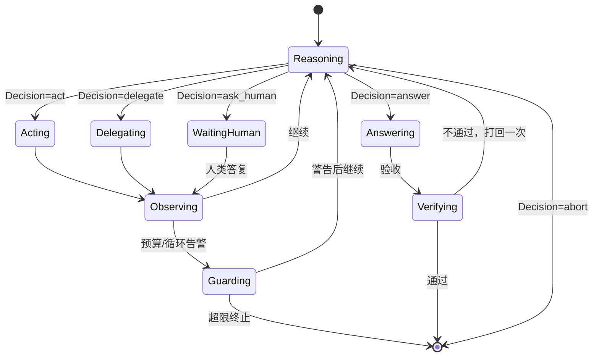
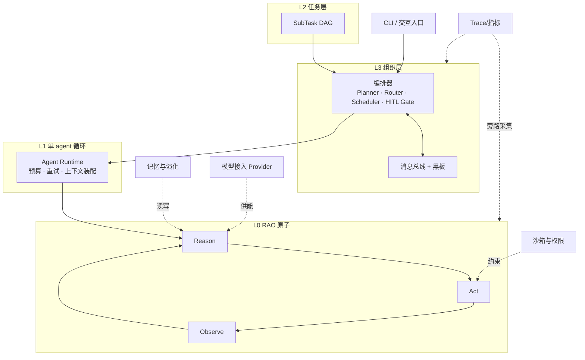
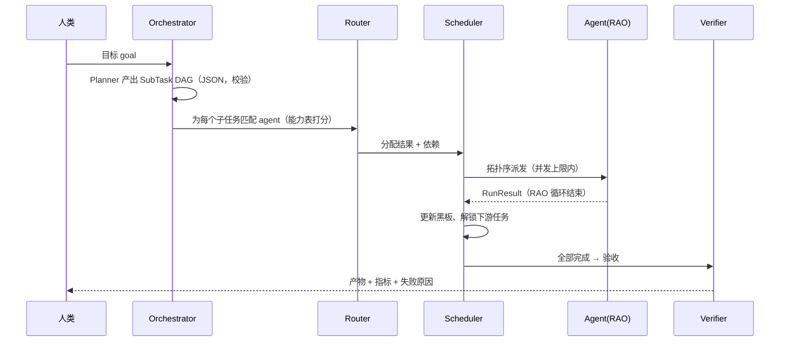

# 系统架构设计：以 RAO 为原子单元的多智能体协作系统

| 项 | 内容 |
|---|---|
| 版本 | v1.3 |
| 日期 | 2026-11-03 |
| 状态 | L0–L1 已实现并测试，L2–L4 设计中 |
| 对应课程要求 | 2.1 通信与协作 / 2.2 记忆演化与隔离 / 2.3 行动空间 / 2.5 UI / 2.6 模型主干 / 评估指标 |
| 代码基线 | `miniagent/`（RAO 原子 + 单 agent 运行时 + 编排器 + 总线，96 个测试） |
| 细化文档 | [RAO 契约规范](rao-spec.md) |

---

## 0. 摘要（TL;DR）

- **原子单元是 RAO**：每一步 = `Reason`（决策）→ `Act`（执行）→ `Observe`（归一化观察）。系统里所有智能行为都是 RAO 序列。
- **RAO 之上有四层**：L1 单 agent 循环 → L2 任务层（分解/调度）→ L3 组织层（多 agent / 委派 / 黑板）→ L4 观测层（trace / 指标 / 评测）。
- **三条贯穿全局的横切能力**：记忆与演化、沙箱与权限、模型接入。
- **最关键的设计决策**：任务的"完成"由**外部可判定的验收函数**决定，而不是模型自己说"我做完了"。没有这一条，完成率指标就不可信。

---

## 1. 设计目标、非目标与不变量

### 1.1 目标

| # | 目标 | 可检验的判据 |
|---|---|---|
| G1 | 一条自然语言指令能端到端完成 | CLI 一次输入 → 产物文件 + 最终答复 |
| G2 | 多智能体能自主分解与委派 | 同一任务在不同输入下产出不同的子任务图 |
| G3 | 完成率与耗时**自动、可追溯** | 一个命令出表，每个数字可追到 trace 行 |
| G4 | 智能体从失败中变好 | 同任务集 A/B（无记忆 vs 有记忆）指标对比 |
| G5 | 隔离可演示 | agent A 无法读写 agent B 的工作区 |
| G6 | 无密钥也能开发与测试 | Mock provider 全链路可跑 |

### 1.2 非目标（明确不做，节省时间）

- 不做 PDF/DOCX/PPT 解析或生成（课程 2.4 明令）
- 不做复杂前端（课程 2.5：网页不加分）
- 不做微服务/分布式调度（单进程足够，见 §7）
- 不做模型微调/训练
- 不做多租户、权限体系、审计合规等企业特性

### 1.3 系统不变量（改代码时不许破坏）

1. **决策闭集**：模型每步只能产出 `act | answer | ask_human | delegate | abort` 之一，不接受自由文本决策。
2. **观察归一**：任何执行结果（成功、失败、超时、被拒）都必须变成 `Observation` 对象。
3. **历史只追加**：对话与步骤历史 append-only，便于重放与审计。
4. **预算单调递减**：步数/时间/token 三个预算只减不增。
5. **完成需验收**：`status=completed` 当且仅当验收函数通过（无验收函数时才退化为"模型声明完成"）。
6. **单一指标来源**：所有指标只能由 `trace.jsonl` 派生，任何模块不得旁路计算。
7. **工具不抛异常**：错误是 `Observation.error_class`，不是异常传播。

---

## 2. RAO 原子设计（L0）

### 2.1 形式化定义

```
s_{t+1} = Observe( Act( Reason(s_t) ) )
```

| 阶段 | 输入 | 输出 | 谁负责 | 失败会怎样 |
|---|---|---|---|---|
| **Reason** | 状态 `s_t`（目标、历史、预算、检索到的记忆） | `Decision`（闭集之一） | LLM | 输出不合 schema → 重试 1 次 → `R_INVALID_DECISION` |
| **Act** | `Decision.actions[]` | 原始结果 `raw` | 本地代码 | 沙箱拒绝/超时/异常 → 变成 `Observation(ok=False, error_class=...)` |
| **Observe** | `raw` | `Observation`（截断、分类、产物索引） | 本地代码 | 截断丢信息 → 记账并告警 |

**与 ReAct 的区别**：ReAct 的 observation 是随意文本，直接塞回上下文；RAO 的 Observe 是**有类型、有截断、有错误分类、有产物索引的对象**。只有把它对象化，才有可能做：失败重试分类、上下文预算控制、记忆蒸馏、指标归因。这是本设计真正的"原子"价值。

> 字段级契约、错误码表、单步测试方法见 **[rao-spec.md](rao-spec.md)**。

### 2.2 状态与决策的数据形状（已实现）

> **字段级契约见 [rao-spec.md](rao-spec.md)**（v1.0，`miniagent/rao.py`，21 个单步测试）。下面只列与架构相关的部分。

```python
class Action(BaseModel):
    id: str                      # 对应 tool_call.id，回填 tool 消息必须匹配
    tool: str
    arguments: dict[str, Any]
    raw_arguments: str
    parse_error: str | None      # 模型输出非法 JSON 时非空

class Decision(BaseModel):
    kind: str                    # act | answer | ask_human | delegate | abort
    actions: list[Action]
    answer: str
    question: str
    delegate: dict
    reason: str                  # 一句话意图（不存长思维链）

class Observation(BaseModel):
    step_id: str
    source: str                  # 工具名 / human / delegate / abort / system
    ok: bool
    content: str                 # 已截断；喂回模型的就是它
    error_class: str | None      # ok=False 时必填（R_/A_/O_/T_ 前缀）
    artifacts: list[str]         # 产物相对路径，供验收与黑板索引
    meta: dict[str, Any]
    bytes: int
    truncated: bool

class RAOState(BaseModel):
    goal: str
    task_id: str
    step_index: int
    history: list[dict]          # OpenAI 消息格式，append-only
    scratch: dict[str, Any]      # repeat 计数、acceptance 失败次数
```

`Budget` 四维（steps / seconds / tokens / actions）由运行时持有、RAO 只消费；`fork(ratio)` 预留给**嵌套委派**（子 agent 再派子任务）。当前编排器给每个子任务一份独立预算（`Limits × 0.8`），并用**全局 token/时间池**兜底：子任务实际用量回扣，池空则剩余任务标 `skipped`。

### 2.3 状态机



### 2.4 终止谓词（**必须外部可判定**）

| 谓词 | 判定者 | 状态 | `error` |
|---|---|---|---|
| `T_accept` 通过 | 验收函数（代码） | `completed` | 空 |
| `T_accept` 打回后仍失败 | 运行时（默认重试 1 次） | `failed_acceptance` | `T_ACCEPTANCE_FAILED: <原因>` |
| `T_budget` | `Budget.exhausted` | `limit_exceeded` | "超过最大步数 N" 等 |
| `T_loop` | RAO 重复计数 ≥5 | `limit_exceeded` | 含 `T_LOOP` |
| `T_abort` | 模型 `abort_task` | `aborted` | "任务被主动中止" |
| `T_error` | Provider / 运行时异常 | `error` | 异常摘要 |

状态闭集：`completed / failed_acceptance / limit_exceeded / aborted / error`。

> **反模式**："模型说完成就算完成"。模型常把"写了一半"说成完成；验收函数必须能独立检查
> 产物是否存在、是否非空、是否满足结构要求（例如"必须包含 ≥3 个 h2 标题"）。

验收函数的三种写法（从便宜到贵，按任务类型选）：
1. 文件存在 + 非空 + 行数下限（最常用，几乎零成本）
2. 结构断言（正则/JSON schema/markdown 标题数）
3. 调用 `run_python` 跑一个断言脚本，或由一个 reviewer agent 判定（成本最高，仅关键任务用）

### 2.5 循环检测

同一动作（`tool` + 规范化参数 的 SHA1 前 16 位）连续重复：

```
≥3 次：向历史注入 "[系统提示] 同一个动作（X）已连续重复 N 次。请换一个策略…"
≥5 次：RAO 返回终止信号 T_LOOP → 运行时置 limit_exceeded
```

"历史增长但工作区无新产物"的检测属于 P2（需要产物索引与步数对齐），当前未实现。

### 2.6 重试策略（按失败类型，不是一刀切）

| error_class | 处理 | 现状 |
|---|---|---|
| `R_INVALID_DECISION` | 回灌错误，等模型下一轮自行纠正 | 已实现 |
| `A_INVALID_ARGS` / `A_UNKNOWN_TOOL` | 回灌校验错误与可用工具列表，不执行 | 已实现 |
| `A_SANDBOX_DENY` | 不重试；回灌"路径越界"，让模型改路径 | 已实现 |
| `A_HUMAN_DENIED` | 不重试；回灌"被拒绝，请换方案" | 已实现 |
| `A_TOOL_TIMEOUT` | 不自动重试（同参数重试交给模型决定） | 已实现 |
| `R_PROVIDER_ERROR` | 指数退避 0.5/1/2s，最多 3 次 | 已实现（Provider 层） |
| `R_CONTEXT_OVERFLOW` | 上下文压缩后重试 | **未实现**（P2，见 §5） |

---

## 3. 分层架构（L0–L4 + 横切）



| 层 | 职责 | 不该做的事 | 当前状态 |
|---|---|---|---|
| L0 RAO | 单步决策与执行契约 | 不关心任务从哪来 | ✅ 已实现（`rao.py`，闭集决策/观察归一/预算/循环检测） |
| L1 循环 | 预算、重试、上下文装配、终止 | 不决定任务拆分 | ✅ 已实现（`agent.py`）——上下文压缩仍属 P2 |
| L2 任务 | 目标 → 子任务 DAG → 调度 | 不实现工具 | ✅ 已实现（`orchestrator.py`：serial + layered） |
| L3 组织 | 多 agent 群聊、委派、黑板、HITL | 不直接执行工具 | ✅ 部分（`bus.py`：群聊/委派已通；HITL 持久化待做） |
| L4 观测 | trace、指标、评测、报告 | 不改变行为 | ✅ 部分（`metrics.py`） |
| 横切：记忆 | 检索注入 + 结束后蒸馏写入 | 不参与调度 | ⏳ `memory.py` |
| 横切：沙箱 | 路径与进程隔离 | 不决定权限策略 | ✅ 软隔离（`sandbox.py`） |
| 横切：模型 | DeepSeek/HKGAI/Mock 统一接口、重试、分层 | 不含业务逻辑 | ✅ `providers.py` |

---

## 4. 组件详设

### 4.1 接入层：CLI

- 命令：`demo`（离线闭环）、`run`（单任务）、`orchestrate`（目标 → 子任务图 → 调度）、`eval`（批量指标）、`report`（汇总）。
- 三种运行模式贯穿全局：`interactive`（每步可看）/ `semi`（只在危险操作与歧义处停）/ `unattended`（自动批准并记录）。
- 输出原则：**默认只打印结论与指标**；`--verbose` 才打逐步事件。演示时用 `--verbose` 讲 RAO 的每一步。

### 4.2 消息总线与黑板（L3，已实现 `bus.py`）

| 概念 | 内容 | 存储 |
|---|---|---|
| 消息总线 | `Message{sender, recipients[], kind, content, task_id}`；kind ∈ chat / report / delegate_request / delegate_result / system | `runs/<id>/bus.jsonl` |
| 黑板 | 任务状态、产物索引、当前决策、冲突记录 | 内存 + `runs/<id>/board.json` 快照 |

分工原则：**总线记"谁说了什么"，黑板记"现在是什么状态"**。不要把状态塞进聊天记录——那会让重放变成猜谜。

群聊的"发言权"由调度器授予（一次只有一个 agent 在 RAO 循环里跑），避免多个 agent 同时写同一文件。

### 4.3 编排器（L2/L3）

**调度算法、失败语义、预算、指标口径与选型记录见 [scheduler.md](scheduler.md)**（S1 串行 /
S2 分层并发 / S3 事件驱动）。本节只交代它在整体架构中的位置。

四个子职责，串成一条流水线：



**Planner 契约**（最容易失控的一环，必须严）：

```json
{
  "goal": "...",
  "subtasks": [
    {"id": "s1", "objective": "...", "assignee": "researcher",
     "deps": [], "acceptance": "产出 sources.md 且 ≥3 条来源"}
  ]
}
```
校验项：id 唯一、deps 无环、assignee 在能力表中、acceptance 非空、子任务数 ≤ `max_subtasks`（默认 6）。
校验失败 → 带错误原文重试一次 → 仍失败则退化为单任务执行（**降级路径必须有**）。

**Router**：能力表 `agent → {skills[], cost, max_concurrency}`；打分 = 技能命中数 − 负载惩罚。
没匹配到 → 派给 generic worker，而不是报错。

**Scheduler**：
- 按拓扑层分批，层内并行，受 `max_parallel` 与模型并发上限约束。
- 失败重试 1 次（换 worker 或同 worker），仍失败标记 `failed`，下游任务标 `blocked`（不要全图失败）。
- 每个子任务拿到 `Limits × 0.8` 的独立预算；全局另有 token/时间池，子任务实际用量回扣，耗尽则剩余任务标 `skipped`。

### 4.4 Agent 运行时（L1）

- 组装 `RAOState`（目标 + 记忆检索结果 + 工具清单 + 预算）。
- 驱动 RAO 直到终止谓词命中。
- 职责边界：**只管一个子任务**，不拆分任务、不写黑板（由调度器统一处理）。

### 4.5 记忆与演化（横切）

**三层记忆**：

| 层 | 内容 | 写入时机 | 读取时机 |
|---|---|---|---|
| Episodic | 一次任务的轨迹摘要（目标、结果、失败类、关键动作） | 任务结束 | 同类任务开始前 |
| Semantic | 归纳出的教训/策略（"写文件前先 list_dir"） | 离线 consolidate | 每步 Reason 前 top-k |
| Skill | 可复用的工具序列（参数化片段） | 任务成功且被复用 | 规划阶段 |

**演化闭环五步**（这是"演化"能被看见的地方）：

```
① record（落盘原始事件） → ② consolidate（LLM 蒸馏成教训，去重、打标签、给置信度）
→ ③ retrieve（按目标+最近观察检索 top-k） → ④ inject（作为"经验"块注入 system 段）
→ ⑤ measure（同任务集 A/B 对比）
```

**演化度量**（报告里直接用它当图表）：

```
evolution_gain = (CR_with_memory − CR_without_memory) / CR_without_memory
step_reduction = (steps_before − steps_after) / steps_before
```
防护：记忆带 `confidence` 与 `source_task`；低置信教训不注入；A/B 可一键关闭注入，防止"记忆污染"反过来拖低指标。

### 4.6 沙箱与隔离（横切）

**分级**（先做 L1，按需升级；架构文档要写清每级能挡什么）：

| 级别 | 手段 | 能挡 | 挡不住 |
|---|---|---|---|
| L1（当前） | 独立目录 + 路径校验（绝对路径/`..`/盘符/符号链接） | 手滑、跨 agent 误读、提示词诱导的越界 | 恶意代码主动访问绝对路径 |
| L2 | 每 agent 子进程 + 受限工作目录 + 资源限制（CPU/内存/超时） | 大部分失控脚本、资源耗尽 | 提权类攻击 |
| L3 | 容器（只挂载自己目录、无网络） | 强隔离、可复现 | 启动成本、Windows 调试成本 |
| L4 | 独立用户 + 系统级策略 | —— | 本课程不需要 |

**权限三档**（与 HITL 联动）：`read`（自由）/ `write`（限额 + 沙箱内）/ `danger`（需批准：删除、覆盖非自有产物、git push、访问非白名单域名）。

### 4.7 工具层（横切）

- 契约：`ToolSpec`（JSON Schema）+ `dispatch(name, args, ctx) -> ToolResult`，**永不抛异常**。
- 必装四类（课程 2.3）：搜索/抓取（`http_get` → 后续接 DeepSeek Search）、文件 CRUD、Python 执行、git 提交推送。
- 统一约束：输出截断（默认 8k 字符）、参数 schema 校验、路径过沙箱、危险操作过审批。

### 4.8 观测与指标（L4）

事件流（`runs/<id>/trace.jsonl`，append-only）：

| kind | 关键字段 | 用途 |
|---|---|---|
| `task_start` | task_id, agent, task, sandbox, acceptance | 计时起点；记录是否启用验收 |
| `step` | step, decision, tools[], ok, error_class, latency_ms, prompt/completion tokens | 一步的审计；区分决策形态与成败 |
| `tool_result` | step, tool, ok, error_class, artifacts[], preview | 失败分类与产物索引 |
| `acceptance` | step, ok, reason | 验收结论（为什么算完成/没完成） |
| `task_end` | status, duration_ms, steps, tool_calls, tokens, error | 完成率与耗时 |
| `plan` | subtasks[]（id/assignee/deps/objective）, attempts | 计划是否合规、拆成了什么 |
| `plan_invalid` / `plan_degraded` | error, attempt | 计划失败与降级（报告里要写） |
| `subtask_start` / `subtask_end` | subtask, assignee, status, duration_ms, tokens | **子任务完成率**（课程要求） |
| `orchestration_end` | status, total, completed, duration_ms, tokens | **总体目标完成率** |

**指标口径（精确，不许各算各的）**：

```
任务完成率   = 通过验收的任务数 / 数据集任务总数
子任务完成率 = status=completed 的子任务数 / 已创建子任务数（不含 blocked）
执行时间     = task_end.ts − task_start.ts（单任务墙钟）；批量另报 makespan 与 P50/P95
失败率分解   = 按 error_class 计数（R_* / A_* / O_*）
单位成本     = tokens/任务、工具调用/任务、模型调用步数/任务
```

### 4.9 模型接入层（横切）

- 统一接口 `chat(messages, tools) -> LLMResponse`，实现：`DeepSeekProvider` / `ScriptedProvider`（测试）/ 预留 `HKGAIProvider`。
- 模型分层：`flash` 做路由、摘要、记忆蒸馏；`v4-pro` 做规划与难题推理。
- 成本控制：三预算护栏、上下文预算（§5）、系统提示词固定前缀（命中缓存，输入价降 ~50 倍）。
- 稳健性：可重试状态码指数退避；响应解析容错（非法 JSON 参数 → `parse_error` 而非崩溃）。

---

## 5. 关键机制：上下文装配与预算

单次请求的 token 预算（默认 8k）：

| 区段 | 预算 | 说明 |
|---|---|---|
| 系统提示词 | 固定 | 放最前面（缓存友好），只随 agent 角色变化 |
| 记忆注入 | ≤15% | top-k，带来源与置信度 |
| 任务与计划 | ≤10% | 目标 + 当前子目标 + 剩余子任务 |
| 历史观察 | ≤50% | 滑窗 + 旧观察摘要化 |
| 工具结果（本步） | 按需 | 单条 ≤8k 字符，超长落 artifacts 只回索引 |

超预算时按"旧观察 → 摘要"→"记忆 top-k 减半"→"历史滑窗"的顺序压缩，并记录 `context_compressed` 事件（报告里要写）。

---

## 6. 数据模型与接口契约

### 6.1 核心模型

| 模型 | 关键字段 | 不变量 |
|---|---|---|
| `SubTask` | id, parent_id, objective, assignee, deps[], status, acceptance, budget | deps 无环；acceptance 非空 |
| `Message` | sender, recipients[], kind, content, task_id | kind 闭集 |
| `Observation` | 见 §2.2 | 必须有 ok/error_class |
| `MemoryRecord` | agent, kind, text, tags[], confidence, source_task, hits | confidence ∈ [0,1] |
| `RunResult` | task_id, agent, status, answer, error, duration_ms, steps, tool_calls, usage | status 闭集 |

### 6.2 模块接口

```python
class RAOUnit:                       # L0：已实现 miniagent/rao.py
    def tool_specs(self) -> list[ToolSpec]: ...            # 注册表工具 + 3 个控制工具
    def decide(self, state: RAOState) -> tuple[Decision, LLMResponse]: ...
    def act(self, state, decision, budget) -> tuple[str, list[Observation], str | None]: ...
    def step(self, state: RAOState, budget: Budget) -> StepRecord: ...

class Agent:                         # L1：已实现 miniagent/agent.py（薄壳：循环/预算/验收）
    def run(self, task: str, task_id: str | None = None,
            acceptance: Acceptance | None = None) -> RunResult: ...

class Orchestrator:                  # L2/L3：已实现 miniagent/orchestrator.py
    def plan(self, goal: str) -> list[SubTask]: ...        # LLM 出计划 + 校验 + 降级
    def run(self, goal: str, scheduler: str = "serial",
            max_parallel: int = 3) -> OrchestrationResult: ...
    # 内部：_dispatch_serial（S1）/ _dispatch_layered（S2）

class Memory:                        # 横切：新增 memory.py
    def record(self, rec: MemoryRecord) -> None: ...
    def retrieve(self, agent: str, query: str, k: int = 5) -> list[MemoryRecord]: ...
    def consolidate(self, agent: str) -> int: ...

class Bus:                           # L3：新增 bus.py
    def post(self, msg: Message) -> None: ...
    def read(self, agent: str, since: int) -> list[Message]: ...

class Acceptance(Protocol):          # 已实现：accept_files / 自定义函数
    def __call__(self, workspace: Path) -> tuple[bool, str]: ...
```

---

## 7. 并发与状态模型

- **单进程 + asyncio**：任务级并发（`Semaphore(max_parallel)`），RAO 循环内部串行。理由：LLM 调用是 I/O 密集，单进程足够；跨进程会引入状态同步成本，收益为零。
- **写者唯一**：同一工作区同一时刻只允许一个 RAO 循环写入（调度器保证）；跨 agent 写同一文件 → 任务级写锁，冲突记入黑板。
- **事件日志优先**：状态可随时由 `trace.jsonl` 重放得出；崩溃恢复 = 从最后一个 `task_end` 继续。
- **幂等**：工具调用带 `step_id`，文件写入先写临时文件再原子替换，避免半成品被下游读到。

---

## 8. 安全模型

| 威胁 | 攻击路径 | 缓解 | 残余风险 |
|---|---|---|---|
| 路径越界 | `../`、绝对路径、符号链接 | `Sandbox.resolve` 全路径校验 | L1 下恶意代码可绕过（需升级 L2/L3） |
| 提示词注入 | 网页/文件里藏"忽略之前的指令" | 外部内容标注为不可信数据；工具权限分级；危险操作须批准 | 模型仍可能被说服执行 read 类越权 |
| 破坏性操作 | 删文件、覆盖产物、git push | `danger` 级必须过 `approve`；unattended 模式也记审计 | 自动批准时可能误删（靠副本/备份兜底） |
| SSRF | 诱导访问内网/本机 | 私有地址/域名黑名单 | 3xx 重定向需逐跳校验（已留 TODO） |
| 资源耗尽 | 死循环、`run_python` 长任务、上下文爆炸 | 三预算护栏 + 工具超时 + 输出截断 | 内存型攻击未限制（L2 加 rlimit） |
| 凭据泄漏 | 把 key 写进文件或日志 | 密钥只从环境变量注入；trace 对疑似 secret 打码 | 模型可能把 key 抄进产物（需过一遍正则扫描） |

---

## 9. 部署与运行

- **形态**：单机 CLI，`python -m miniagent ...`；无服务端、无数据库（JSONL/JSON 足够）。
- **目录**：`runs/<run_id>/{trace.jsonl, report.md, agents/<agent>-<task>/}`，每次运行天然隔离且可复现。
- **配置**：环境变量（`DEEPSEEK_API_KEY` / `DEEPSEEK_MODEL` / `MA_TEMPERATURE`），不做多环境。
- **CI（可选但建议）**：GitHub Actions 跑 `python -m unittest discover`，用 ScriptedProvider，不花一分钱。

---

## 10. 与课程要求的对照（traceability）

| 课程要求 | 设计位置 | 证据（怎么演示） |
|---|---|---|
| 2.1a 一对一 / 群聊 | `bus.py` + CLI 会话 | 三个 agent 在同一任务里轮流发言的记录 |
| 2.1b 自主委派 | `orchestrator.py`（Planner/Router） | 同指令两次运行产出不同子任务图 |
| 2.1c HITL | RAO `ask_human` + `danger` 审批 | 删除文件时停下等确认；拒绝后换方案 |
| 2.2a 记忆与演化 | `memory.py` + A/B 实验 | 演化增益表（完成率/步数前后对比） |
| 2.2b 隔离 | `sandbox.py` + 分级表 | agent A 读 agent B 目录被拒的日志 |
| 2.3 行动空间 | `tools.py`（搜索/文件/代码/git） | 四类工具各一次调用记录 |
| 2.4 只用 md/txt | system prompt + 无 PDF 依赖 | 依赖清单里没有 docx/pdf 库 |
| 2.5 极简 UI | `cli.py` | 一个终端窗口完成全流程 |
| 2.6 DeepSeek/HKGAI | `providers.py` | 请求日志里的 base_url 与模型名 |
| 评估指标 | `metrics.py` | 一键出完成率/耗时/P95/失败分类表 |

---

## 11. 演进路线（与现有代码对齐）

| 阶段 | 内容 | 涉及文件 | 状态 |
|---|---|---|---|
| P0 | 单 agent 隐式 RAO + 工具 + 沙箱 + 指标 | `agent.py` `tools.py` `sandbox.py` `metrics.py` | ✅ 已完成 |
| P1 | **RAO 显式化**：`rao.py`（Decision/Observation/StepRecord/RAOUnit）+ 验收函数 + 循环检测 + 错误分类 | `rao.py`（新）、`agent.py`、`cli.py` | ✅ **已完成**（21 个单步测试） |
| P2 | 任务层：Planner + DAG 调度 + 降级 + 失败局部传播 | `orchestrator.py`（新） | ✅ **已完成**（S1 串行 + S2 分层并发） |
| P3 | 组织层：总线 + 群聊 + 委派 + HITL 持久化 | `bus.py`（新）、`orchestrator.py` | ✅ 部分完成（总线/群聊/委派已通；HITL 持久化留待 P4） |
| P4 | 记忆与演化 + A/B 实验 | `memory.py`（新） | ⏳ |
| P5 | 批量评测 + 基线对照 + 报告 | `evals/`、`metrics.py` | ⏳ |

> P1 已落地：`RAOUnit.step()` 是唯一执行入口，错误被分类成 `R_/A_/O_/T_`，
> 完成判定改为外部验收函数。P2 的调度器可以直接驱动单步、断言中间状态。

---

## 12. 设计取舍与已知限制

| 取舍 | 选择 | 理由 | 代价 |
|---|---|---|---|
| 框架 | 不用 LangChain | 评分看"你的路由逻辑"；黑盒会吞掉指标与循环边界 | 要自己写 ~300 行编排 |
| 架构 | 单进程 asyncio | 规模小、可预测、好复现 | 不能横向扩展（本课程不需要） |
| 状态 | 事件日志为主 | 可重放、可审计、天然支持"可复现" | 需要写重放/汇总脚本 |
| 隔离 | L1 软隔离优先 | 4 周内可落地且可演示 | 不是安全边界，须在文档中声明 |
| 记忆 | JSONL + 关键词/轻向量 | 条目量小，向量库是过度设计 | 语义召回弱（可后续加 embedding） |
| 完成判定 | 外部验收函数 | 指标可信 | 需为每类任务写验收规则 |

**已知限制（写进报告的"未来工作"）**：软隔离、无流式输出、`http_get` 未禁用自动跳转、ScriptedProvider 的 token 为估算值、并发上限依赖单机。

---

## 附录 A：目标目录结构

```
miniagent/
├─ rao.py            # L0：Decision / Observation / Budget / RAOUnit（已实现）
├─ agent.py          # L1：循环驱动 + 预算 + 验收 + 终态映射
├─ orchestrator.py   # L2/L3：Planner / Router / Scheduler（S1 串行 + S2 分层并发，已实现）
├─ bus.py            # L3：消息总线（群聊/私信/委派事件，已实现）
├─ memory.py         # 横切：三层记忆 + 演化（P4）
├─ tools.py          # 工具注册表与默认工具集
├─ sandbox.py        # 路径隔离（L1）
├─ providers.py      # DeepSeek / Scripted / HKGAI
├─ metrics.py        # trace -> 指标
├─ schemas.py        # 数据契约（全体 review 才能改）
├─ config.py         # 预算与护栏
└─ cli.py            # demo / run / eval / report
evals/               # 任务集与批量评测（P5）
runs/                # 每次运行的产物与 trace
docs/                # 本文档 + RAO 规范 + 调度器设计 + 要求分析 + 分工
tests/               # 96 个用例（RAO 单步 + 编排调度 + 总线 + CLI）
```

## 附录 B：术语表

| 术语 | 含义 |
|---|---|
| RAO | Reason-Act-Observe，本系统的原子单元 |
| Decision | Reason 阶段的输出，闭集五选一 |
| Observation | Act 结果的归一化对象（ok/error_class/artifacts） |
| SubTask | 编排器产出的最小任务单元，带 assignee 与 acceptance |
| 黑板 | 共享状态（任务状态、产物索引），区别于消息流 |
| 验收函数 | 代码实现的完成判定，替代"模型自述完成" |
| 演化增益 | 有记忆 vs 无记忆在同一任务集上的指标差 |
| 预算切分 | 父任务把剩余预算分给子任务 |

## 附录 C：变更记录

| 版本 | 日期 | 变更 |
|---|---|---|
| v1.0 | 2026-11-03 | 初稿：确立 RAO 原子、四层架构、验收驱动的完成判定 |
| v1.1 | 2026-11-03 | P1 落地：`rao.py` 实现（闭集决策、观察归一、预算、循环检测、验收、错误分类）；`agent.py` 改为薄壳；事件表与接口契约按实现校正；新增 [rao-spec.md](rao-spec.md) |
| v1.2 | 2026-11-03 | P2 落地：`orchestrator.py`（计划校验+降级、能力路由、S1 串行拓扑、S2 分层并发、失败局部传播、黑板）；指标新增子任务层与总体目标口径；补调度器选型对比 |
| v1.3 | 2026-11-03 | P3 部分落地：`bus.py`（群聊/私信/委派事件）、S3 事件驱动调度、`delegate_task` 真委派（限深）；调度器细节独立成 [scheduler.md](scheduler.md)，§4.3 改为引用 |
