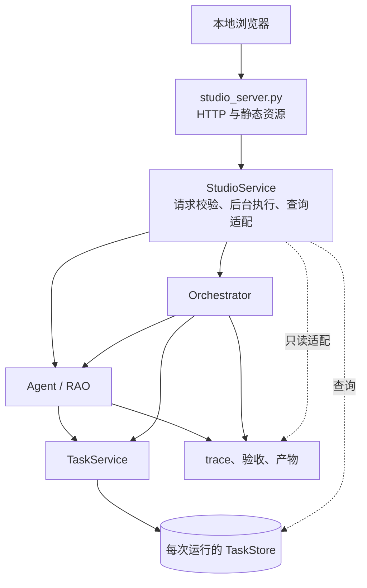

# M0-UI-01：轻量本地网页工作室

当前版本的自定义角色、群内分工、运行中答复、累计预算及失败续聊操作，见 [团队任务与续聊](studio-team-workflow.md)。以下包含早期版本的验收记录。

> 2026-11-17（America/Los_Angeles），开发分支 `jinyuwu/local-studio-gui`。本次给已有任务执行能力增加可视化入口：发起任务、任务树、运行状态、日志、文本产物和验收报告。已支持用项目私聊或群聊追问并迭代产物。侧栏「角色库」支持创建长期助手、维护跨会话记忆、编写与审核技能。操作见[个人角色库](personal-role-library.md)。

## 1. 启动与体验

macOS 可双击仓库根目录的 [Start Studio.command](<../Start Studio.command>)。启动器定位到项目目录，使用 `.venv/bin/python` 启动 `studio --open` 并打开默认浏览器；启动服务本身不会创建模型任务。若没有虚拟环境，终端会显示创建 `.venv` 和安装 `requirements.txt` 的步骤，等待用户处理。

命令行入口继续保留，在仓库根目录使用已有虚拟环境：

```sh
.venv/bin/python -m miniagent studio --port 8765 --runs-dir runs
```

浏览器打开 <http://127.0.0.1:8765>；也可以加 `--open` 在启动时打开默认浏览器。`--env-file /path/to/config.env` 指定配置文件，`--no-env` 仅使用进程环境变量，两者不能同时使用。服务只监听本机地址；无需 Node、前端构建或额外 Python Web 框架。页面使用仓库内的 HTML、CSS、JavaScript，字体和资源不依赖远程 CDN。

先选择离线演示：

1. 单任务演示运行已有 ScriptedProvider 工具闭环，生成文件并独立验收。
2. 协作演示运行 worker → writer 的两个子任务，展示父子关系、依赖、分工和 root 验收。
3. 从运行列表选择本次运行，查看任务树和事件；在产物页签阅读生成的文本，在验收页签检查报告。
4. 刷新页面或重开浏览器，读取同一运行的持久记录，不重新提交任务。

离线演示中的模型回复来自固定脚本，文件工具、任务登记、调度、验收和记录写入仍真实执行。它证明产品与运行链路可用，不证明真实模型对未知目标的规划能力。

真实单任务和协作模式使用服务端配置的 DeepSeek。启动 `studio` 时可从本地 `.env` 读取配置，进程中已经存在的环境变量优先；解析器只处理允许的配置项与字面量，不执行命令、插值或 shell 脚本。API key 不进入 HTML、浏览器存储、响应或任务启动请求。其他 CLI 命令保持原来的环境变量行为。

真实单任务支持填写相对输出文件路径，检查文件存在且非空；这只能证明指定文件已生成，不能证明网页可玩或业务目标完整实现。协作演示内置子任务与 root 的独立验收。**真实多 Agent 模式尚未开放网页自定义协作验收，不能据此承诺任意任务可以完成并通过验证。** 表单在启动前直接呈现这一限制；复杂规则仍通过 `orchestrate --acceptance` 的现有配置入口提供。

未配置密钥时仍可使用离线模式。执行未报错但没有独立验收的结果保持 `unverified`；执行失败应保留失败结论，UI 不因为模型给出答案或生成文件而显示“验收通过”。本次没有新增无人值守自动批准开关。

## 2. 范围与产品交互

| 用户操作 | 数据来源 / 行为 | 当前边界 |
| --- | --- | --- |
| 发起任务 | POST 经校验后建立运行目录，由后台执行 Agent 或 Orchestrator | 同一个请求标识重复发送不会重复执行；新的任务使用新请求标识 |
| 选择运行 | 列出配置的 runs 目录中的可读取运行 | 默认仍为每次运行一个数据库，尚无统一项目/角色注册表 |
| 查看任务树 | TaskStore 的 task_id、root_id、parent_id、deps 和 assignee | 展示持久父子关系和依赖，不从自然语言日志猜任务关系 |
| 查看状态 | 持久 Task 状态 + 工作室作业状态 | 后台线程结束、任务已完成、验收已通过是三个不同概念 |
| 查看日志 | 当前运行的 trace 事件，显示事件类型、时间和关联任务 | 最多返回 300 条事件；截断明确展示，不声称浏览器包含完整审计历史 |
| 查看诊断 / 导出 | 从持久任务、验收和日志推导执行原因、阻塞链与配置；导出页面当前快照 | 执行状态与验收状态分别呈现；只读推导，不改写历史结果，不声称导出完整日志 |
| 阅读产物 | 允许的任务工作目录中的文本文件 | 只读、预览最多 256 KiB；不给任意路径文件服务，不执行内容中的 HTML/脚本 |
| 查看验收 | 已保存的 AcceptanceSpec/Report、证据回执和运行报告 | 无报告、unverified、failed、error 与 passed 分开显示 |

课程 2.5 原文要求界面保持简单实用，并明确允许 “a basic Gradio/Streamlit text interface”；没有要求只做 CLI。本次按用户选择接入本地网页任务控制台，保留 CLI 作为脚本与评测入口。

协作式取消已在 M0-H01 接入。以下项目会话支持上一轮结束后的问答和修改。运行中的消息投递、角色管理与可恢复审批在开发计划中单独跟踪。

### 在一个项目里继续对话

打开侧栏的「对话」，点击「新建私聊」选择一位角色，或点击「新建群聊」选择多位成员，再指定本条消息由谁处理。一个群可以让 worker 改代码、让 reviewer 读代码解释设计，定向消息由所选角色回复。开启群内协作后，所选负责人可以向其他成员委派任务，成员的交接及用户答复会进入同一会话。

在已结束的单 Agent 工作室任务（包括旧版运行）的「对话」页签，选择「只读问答」可以接着问「速度在哪里设置」，选择「执行或修改」可以要求「把默认速度调慢」。提问回合使用只读文件工具，保留上一版项目。修改回合从最近一次正常结束的修改载入支持的项目文件，生成独立运行，可为该轮设置验收文件。已通过验收和未配置验收但正常结束的修改都可以成为下一版的基础。失败或取消的草稿保留在当轮，后续修改使用前一可用版本。返回旧运行仍可读取当时的文件与验收报告。群聊中的其他成员可以接手同一项目的下一轮。项目快照支持 UTF-8 文本和代码，单文件上限 8 MiB，合计上限 20 MiB。工作区含无法完整交接的非隐藏文件或链接时，服务会说明原因。

会话的 HTTP 回归使用本机临时服务和离线模型，依次由 worker 写入第一版、reviewer 实际读取文件回答问题、worker 在继承的文件上执行局部编辑，并核对旧版本、会话列表、各轮回复和验收历史。[端到端测试](../tests/test_studio_chat_http.py)

## 3. 运行架构与读写职责



- `miniagent/web/` 负责布局、表单、运行选择、轮询和呈现。页面对日志与产物使用文本渲染，不将任务输出作为可执行模板。
- `studio_server.py` 负责 HTTP 输入和响应、静态资源白名单、来源校验与本机访问边界；它不实现第二套任务状态机。
- `studio_service.py` 负责提交请求去重、有界后台执行、运行发现与数据适配；不通过拼接 shell 命令调用 CLI，也不全局重定向 stdout。
- Agent、Orchestrator、TaskService 继续负责执行、依赖、验收和事务收尾；完成判定沿用 M0-02/04。
- TaskStore 是任务生命周期真源；Studio 作业元数据记录启动参数、时间和宿主执行状态。作业状态不会替代或修补数据库中的业务状态。

HTTP 的运行 `id` 是运行目录标识，不等于 M0-01 `RunRecord.run_id`。一个工作室运行可包含 root、多个子任务及其各自 Attempt/Run。界面使用前者选择一次运行，任务详情中的执行身份仍来自后者。

页面通过查询轮询状态，因此刷新不会丢失后端工作，也不会重新调用模型。轮询按稳定标识更新已有 DOM，耗时变化和新增日志不会重新挂载整页；原有日志节点、展开项、焦点、文本选择和阅读位置尽量保持。页面不播放重复入场动画。

后台默认最多同时执行两次工作室运行；满载时明确拒绝新启动请求，不让无限任务积压。当前服务没有持有执行归属的未结束工作室作业，API 使用 `interrupted`，界面显示“待核实”；这只表示当前服务无法确认原执行者是否仍活跃，不能据此断言进程已死亡或可以安全重试。此时耗时未知，显示 `—`；不会把 TaskStore 的 running 擅自改成 completed，也不会盲目续跑工具。已有 CLI 运行可以只读查看，缺少数据库或损坏记录不能被升级为已验证成功。

## 4. HTTP 接口

以下接口仅面向同机工作室页面，并非公开多租户服务 API。日志读取使用最新 4 MiB 的有界尾部，详情最多返回最近 300 条事件；超过读取范围时 `summary_incomplete=true`，页面将 token 等指标标为部分记录，不把它们当作完整账单。

| 接口 | 输入 / 输出 | 职责 |
| --- | --- | --- |
| `GET /api/bootstrap` | 服务端模型、thinking、密钥是否可用、模式与请求令牌 | 提供启动所需状态，永不返回 API key |
| `GET /api/runs` | 运行摘要列表与活动数量 | 当前目录中的运行发现与状态摘要 |
| `GET /api/conversations` | `conversations` 数组，包含类型、成员、标题、最新回合和轮数 | 从会话入口重新进入同一项目 |
| `GET /api/runs/{id}` | 运行摘要、任务、事件、产物索引、验收、指标报告与 `diagnostics` | 一次运行的只读快照；诊断不替代持久状态 |
| `GET /api/runs/{id}/artifact?path=...` | 相对路径 → 文本内容与截断标记 | 受限文本预览 |
| `POST /api/runs` | JSON 启动请求（可选 `limits`、`conversation`）→ `202` 与运行摘要 | 校验、请求去重、提交后台执行 |
| `POST /api/runs/{id}/cancel` | 空 JSON 对象 → `202` 与运行摘要 | 同源及 CSRF 校验后请求协作式停止；幂等 |
| `GET /api/runs/{id}/artifacts.zip` | 已结束运行 → ZIP 附件 | 保留产物相对路径，执行失败也可导出 |

`diagnostics` 包含 `execution_status`、`acceptance_status`、`issues`、`blocked_tasks`、`current_activity`、`configuration` 和 `incomplete`。例如，旧运行可以同时呈现持久总状态 `unverified`、推导执行状态 `failed`、验收状态 `not_configured`；三者分别说明历史结果、执行事实和检查配置，不能混为一次验收失败。

新运行写入 `studio_configuration` 配置快照：模型、thinking、单次输出上限、请求超时/截止时间、重试次数、步数/时间/token 预算及调度模式。规划和 Agent 步骤记录开始事件，完成记录包含可用的结束原因、请求标识、延迟和输出上限；步骤开始到结束包含工具执行时间，不能解释为纯模型请求耗时。旧记录没有的字段显示未知，不能用当前服务配置冒充当时配置。

工作室异常记录异常类型及最多 8 个栈帧的文件名、函数名、行号，不保存局部变量、源代码行或原始异常消息。底层存储本身故障时，错误日志仍可能无法落盘。响应沿用敏感字段及当前 API key 的脱敏处理；诊断导出仍包含任务文本和工具记录，不等于匿名数据。导出由浏览器保存当前响应中的运行、诊断、任务与最近事件，并携带截断标记；它没有额外读取完整 trace。

会话复用 `POST /api/runs`。使用 `mode="single"`，把用户原话放在 `objective`。首次请求的 `conversation` 示例为 `{"kind":"group","members":["worker","reviewer"],"recipient":"worker","intent":"edit"}`。私聊使用 `"kind":"dm"` 和一位成员。后续请求示例为 `{"parent_run_id":"<最新一轮的运行 ID>","recipient":"reviewer","intent":"question"}`。接收人必须属于此会话。后端保留原始任务目标，按总量上限向下一轮提供近几轮公开消息的摘录。需要了解具体实现时，角色可以读取当前项目文件。提问回合留空 `acceptance_files`。角色 ID 及显示名来自 `GET /api/bootstrap` 的 `conversation_roles`。

详情接口的 `conversation` 返回会话 ID、类型、成员、`turns`、`head_run_id`（最新消息所在运行）和 `artifact_run_id`（项目文件所在运行）。每条回复有独立的 `run_id`，可回到该轮查看执行记录。提交下一条消息以最新回合为依据，重试同一条消息时复用原 `request_id`。

离线任务的启动请求示例：


```json
{
  "request_id": "7684919e-7553-4ac6-9f1d-e7e436b77cfb",
  "mode": "demo",
  "objective": "",
  "scheduler": "serial",
  "thinking": "disabled",
  "acceptance_files": []
}
```

`mode` 可选离线单任务 `demo`、离线协作 `team-demo`、真实单任务 `single`、真实协作 `team`。离线协作使用固定串行脚本；真实协作可选择已有调度模式。`acceptance_files` 最多包含 20 个不重复的相对输出路径，不允许借验收输入访问任意宿主路径；GUI 中只对真实单任务启用，`team` 模式拒绝非空列表。`request_id` 必须是 UUID，任务描述最多 10000 字符。同一 request_id 和同一规范化请求返回同一运行；同 ID 携带不同请求明确冲突。

POST 使用 `application/json` 和 bootstrap 下发的 `X-Studio-Token`，同时校验同源 Origin。服务器限制 Host 与请求体大小（64 KiB），不开放跨域访问。错误使用结构化响应，不把任意底层异常、配置值或密钥反射回页面。

## 5. 文件与执行边界

静态文件只从固定 Web 资源集合返回。产物预览仅允许选定运行下的任务工作目录、支持的文本扩展名和有界大小；拒绝路径穿越、隐藏敏感路径、符号链接及越界目标。支持 `.html`、`.css`、`.js` 源文件的文本预览；它们经转义后显示，不嵌入 iframe、不执行脚本，也不能据此判断生成的网页实际交互正确。Markdown 的原始 HTML 同样经转义，只有受限的排版转换。

这些是本地 HTTP 的读取与请求边界，不能替代 M0-05 的 ExecutionBackend。现有 `run_python` 仍是宿主 Python 软隔离；GUI 没有让它获得容器隔离，也没有扩大已有授权。电脑维护演示应使用受控任务与临时工作副本，真实宿主维护能力仍按 M0-05/08 接入。

本次不部署云端、不绑定 `0.0.0.0`、不提供远程登录或多用户权限；若以后开放远程访问，需要单独设计身份、授权和作业归属。

## 6. 视觉与动效依据

早期布局参考了 [Linear 的界面重构说明](https://linear.app/now/how-we-redesigned-the-linear-ui)和 [Raycast 的视觉更新说明](https://www.raycast.com/blog/a-fresh-look-and-feel)。用户反馈表明，仅将暖色改为蓝灰色不能解决信息层级与可读性问题。本次进一步查阅了下列官方 skill 原文，采用其中适合任务工作台的设计原则；没有安装或执行第三方脚本，也没有声称完成其完整自动审查流程。

| 参考 | 阅读内容 | 在本工作室的应用 |
| --- | --- | --- |
| [Anthropic frontend-design](https://github.com/anthropics/skills/blob/main/skills/frontend-design/SKILL.md) | 从产品内容确定视觉方向，减少模板化装饰与空泛文案 | 减少英文眉题、装饰性标题和无关信息，让任务目标与实际结果成为视觉重点 |
| [Impeccable](https://github.com/pbakaus/impeccable/blob/main/.agents/skills/impeccable/SKILL.md)及其 [Operate 指南](https://github.com/pbakaus/impeccable/blob/main/.agents/skills/impeccable/reference/operate.md) | 工具界面的信息扫描、熟悉交互、排版、状态和克制动效 | 正文以 14px、辅助文字以 12px 为基准；保留固定布局和清楚的状态；取消整页入场动画 |
| [Vercel web-design-guidelines](https://github.com/vercel-labs/agent-skills/blob/main/skills/web-design-guidelines/SKILL.md)及其[规则正文](https://github.com/vercel-labs/web-interface-guidelines/blob/main/command.md) | 焦点、异步更新、长内容、错误恢复和响应式检查 | 稳定轮询节点、可键盘操作的控件、明确错误原因与后续动作、窄屏阅读与减少动态效果 |

主工作区采用白色与浅中性表面，主要操作和选中项使用一致的强调色；成功、警告和错误有文字及独立语义颜色。标题、正文和元信息形成层级，日志中的代码和数据使用等宽字体。窄屏通过折叠导航和重排内容适配，不把所有文字继续缩小。交互过渡只说明选择、展开和反馈，不用动画伪造任务进度。

本地资源不加载第三方字体、追踪脚本或图片服务。加载、失败、空状态和未配置模型均采用同一视觉语言；任务详情优先回答“发生了什么、停在哪一步、下一步是什么”。

## 7. 验证与复现

后端测试覆盖真实离线执行、任务和验收持久记录、重复启动请求、重开目录、输入与 HTTP 来源限制、产物路径和文本读取边界。完整回归继续运行原有契约、provider、验收、调度与 TaskStore 用例。

```sh
.venv/bin/python -W error::ResourceWarning -m unittest discover -s tests -t . -q
```

初版 GUI 的历史基线为 545 项完整回归通过（M0-04 基线 504 项加 GUI 41 项，2026-11-17）。这不代表下述问题修复已由旧测试覆盖。本次新增回归覆盖输出截断诊断、执行失败与验收的区分、配置与异常元数据、日志截断和敏感字段处理；应以当前代码重新运行上面的完整测试命令。真实模型任务的成功率不由离线回归证明。

初版浏览器已实际验证下列交互，作为历史基线保留；持续运行稳定性使用下方新增 fixture 单独验证：

| 检查 | 已观察结果 |
| --- | --- |
| 启动与空状态 | 页面读取本地服务状态；无运行时显示开始任务的入口 |
| 单任务与协作演示 | 从页面按钮启动；轮询显示 running → completed；真实执行并保存产物 |
| 任务树 | root 和子任务展开后可见持久任务身份、执行尝试和依赖 |
| 日志 | 可以筛选事件并展开原始记录 |
| 产物 | 两个协作产物均可选择并阅读 Markdown |
| 验收 | 协作演示显示三个通过报告，包含子任务与 root |
| 页面刷新 | 保持同一运行，不重复创建任务 |
| 服务重启 | 断开时显示重连提示，重启后重新读取原有两个任务，没有新增执行 |
| 报告保存 | 从页面保存 Markdown，下载得到真实 report.md |
| 未配置真实模型 | 真实任务表单明确拒绝启动，离线演示仍可使用 |
| 窄屏 | 390px 视口无水平溢出，内容按窄屏布局呈现 |

以上浏览器记录只证明本地交互与离线链路；自动恢复、真实宿主隔离、角色/skill 培养或未知任务性能仍需各自阶段证据。

### 持续运行时的浏览器稳定性回归

```sh
.venv/bin/python tests/web/serve_stability_fixture.py
```

打开 <http://127.0.0.1:8767>，等待约 10 秒，检查页面右下角的 PASS/FAIL 列表；完成后在启动终端按 Ctrl+C 停止 fixture。该服务只绑定本机，加载真实 `app.js` 和样式，在应用启动前替换测试页面的 fetch，以持续变化的耗时、revision 和事件模拟轮询。它不会读取用户运行数据、调用模型或执行任务工具，不属于正式工作室服务。

九项断言分别检查：两轮变化后的页面节点身份、已有日志节点身份、日志展开状态、筛选器焦点、证据文本选择、阅读位置、页面没有重新播放入场动画、日志窗口滚动后仍对应同一事件、验收证据保持展开。此 fixture 用于验证实际 DOM 交互，不能用静态截图或“页面能加载”代替；也不验证真实模型调用。

## 8. 首次真实任务失败的诊断记录

用户任务“帮我完成一个贪吃蛇web游戏”对应运行 `studio-20261117-042241-18dcd49cc364`。对该目录中的原始 `trace.jsonl` 和任务记录做只读调查，观察到：

| 证据 | 发生的事情 |
| --- | --- |
| `s1` / `writer` 第 1 步 | `list_dir` 成功；模型结束原因 `tool_calls` |
| `s1` 第 2 步 | 模型延迟 22,828.83 ms，约 23 秒；输出 4,096 token，`finish_reason=length` |
| 协议与工具记录 | 运行返回 `T_PROTOCOL`；未完成的 `write_file` 调用标记 `A_SKIPPED`，没有执行这次截断写入 |
| 下游依赖 | `s2` 因 `s1` 未完成而 blocked，`s3` 因 `s2` 未完成而 blocked |
| 旧版 root 结果 | 总状态保存为 `unverified`，原因是 `no-acceptance`；这一汇总掩盖了前面的真实执行失败 |

因此这是两个独立问题：模型输出被截断导致执行中止，同时该真实协作任务没有配置独立验收。不能把它解释成“游戏已经实现，只是检查没通过”。旧日志没有完整的运行配置快照；4,096 是已记录的输出用量，不能用当前服务环境反推未保存的配置。

修复后，新运行在存在子任务执行失败时保留失败结论，缺少验收不能覆盖它；诊断同时呈现输出结束原因、可用的输出上限、关联步骤、阻塞链和验收状态。原运行的数据库、trace 和状态保持不变，查看旧任务时明确说明“历史总状态未验证，但日志确认执行失败”。

页面建议缩短单次输出、分段生成文件，或调整 `DEEPSEEK_MAX_TOKENS` 后重启服务并由用户发起新任务；提高上限会增加可能的单次用量，不能保证未知任务成功。本次没有自动重放失败任务、执行截断参数、放松验收规则或补写成功记录。网页自定义协作验收仍是后续缺口。

### 本次修复后的验证记录

2026-11-17 在实际仓库执行完整回归：**565 项全部通过**（6.102 秒，`ResourceWarning` 作为错误）。JavaScript 语法检查与 `git diff --check` 通过。

最终页面的持续轮询夹具 **9 项全部 PASS**，浏览器控制台无错误或警告。使用首次失败运行的副本，实际检查诊断证据、阻塞链、错误日志筛选和 JSON 下载；导出内容为 `execution_status=failed`、`acceptance_status=not_configured`、22 条事件、2 个受阻任务。390px 手机视口内容宽度为 390px，无水平溢出。原始运行与 `.env` 未修改，没有重新发起真实模型任务。

正在运行的旧 Studio 进程不会热加载 Python 修改：在原启动终端按 `Ctrl+C` 结束服务，再双击仓库根目录 `Start Studio.command`。刷新浏览器后读取同一份历史任务。


## 2026-11-17 输出预算调整（历史记录，后续由 M0-H01 补齐轮数限制）

按用户要求，将项目默认单次输出上限及本机配置提高至 **300000 token**。官方 `deepseek-flash` 的上下文窗口为 1M，Chat Completions 的 `max_tokens` 范围为 1..393216；上下文窗口、单次输出上限、任务多轮累计预算是不同参数。500000 不能作为该接口的 `max_tokens`。上限不代表模型必须输出这么长，正常 `stop` / `tool_calls` 仍可提前结束。

为避免下一级限制立即中止长任务，`Limits.max_total_tokens` 从 200000 改为 1000000（现有子任务 0.8 分配后为 800000），`Limits.max_seconds` 从 120 改为 3600；provider 的 socket 等待从 60 改为 120 秒，总请求 deadline 从 120 改为 3600 秒。步数 12、每轮工具数 4、工具超时 20 秒保持原值。这些是项目运行策略，并非官方 SLA；现有任务预算仍是轮次间检查和事后累计，不是严格的费用预留账本。

新默认值统一用于 Settings、直接构造 Provider 和环境变量缺省值；`.env.example` 同步更新。已验证本机 `.env` 的三个非密钥数值项已更新，密钥内容保持原样。历史事故日志、旧配置快照与 M0-03 线上验证记录中的 4096 保留为当时的证据。

完整离线回归 **566 项通过**（39.722 秒，ResourceWarning 作为错误），包括模拟 300000 输出 token 的工具调用后继续第二轮并通过独立验收；该用例不会真实生成或消费 30 万 token。未重新发起付费任务。

官方依据：[Models & Pricing](https://api-docs.deepseek.com/quick_start/pricing/)、[Chat Completions max_tokens](https://api-docs.deepseek.com/api/create-chat-completion/)、[连接保活说明](https://api-docs.deepseek.com/quick_start/rate_limit/)。


## M0-H01：执行预算、恢复与成果取回

最新游戏任务实际耗尽的是 **12 轮调用**：全部响应 `finish_reason=tool_calls`，累计 completion 为 31709 tokens；四个代码文件已生成。完整复盘、开源依据、基础能力验收及下一阶段见 [Harness 基础能力](harness-foundations.md)。历史运行保持原样，页面从日志区分轮数、输出截断、累计 token、时间、重复循环与验收失败。

当前默认 100 轮、3600 秒、累计 token 不限（0）。单次输出上限仍为 300000。真实模型任务的“选项”可覆盖前三项，只影响新运行。`limits` 示例为 `{"max_steps":200,"max_total_tokens":3000000,"max_seconds":7200}`；允许范围分别是整数 1..1000、整数 0..100000000、数值 1..86400。续聊时可点“本轮设为不限”覆盖上一轮的累计额度，历史配置仍可核查。环境入口为 `MA_MAX_STEPS`、`MA_MAX_TOTAL_TOKENS`、`MA_MAX_SECONDS`。这些限制不是严格费用预留，实际调用可能在收到响应后才确认超支。

默认最多进行两次输出截断恢复；不完整工具调用不执行，恢复也消耗原任务轮数和 token。旧历史与下一轮请求视图分离，必要时按完整工具批次裁剪；这是明确告知的历史省略，尚未实现语义摘要。文件工具新增 `edit_file` 和 `append_file`，`read_file` 支持分页并返回完整文件 hash，避免反复重写整个文件。

运行中的“停止任务”会记录 `cancel_requested`。当前同步 HTTP 或工具执行可能仍在等待；到达下一边界后停止，不再启动新工具，并把持久任务写为 `cancelled`。重复点击不会重复收尾。停止已结束的任务不会改写原状态。它不是强制杀进程，也不是断点恢复。

产物页提供 ZIP 下载：单 Agent 的 `index.html`、CSS、JS 及嵌套测试文件保留相对路径；多 Agent 保留各自目录。只打包已有文本/代码白名单，排除隐藏文件、控制数据库及软链接；单文件最多 8 MiB、总计最多 20 MiB，超过范围明确拒绝，不交付静默截断的压缩包。服务仍持有执行权时拒绝整包下载，逐个预览仍可用。下载并不代表产物通过功能验收。


本轮最终仓库回归：**631 项测试通过，6.684 秒**，ResourceWarning 作为错误；`git diff --check` 与 JavaScript 语法检查通过。真实浏览器验证预算覆盖、协作取消、失败运行 ZIP 下载、9 项轮询稳定性以及 390px 无横向溢出。测试模型为离线夹具，没有新增付费请求。原游戏压缩包下载后四个文件与源产物逐字节一致；游戏本身尚未据此升级为已验收。
